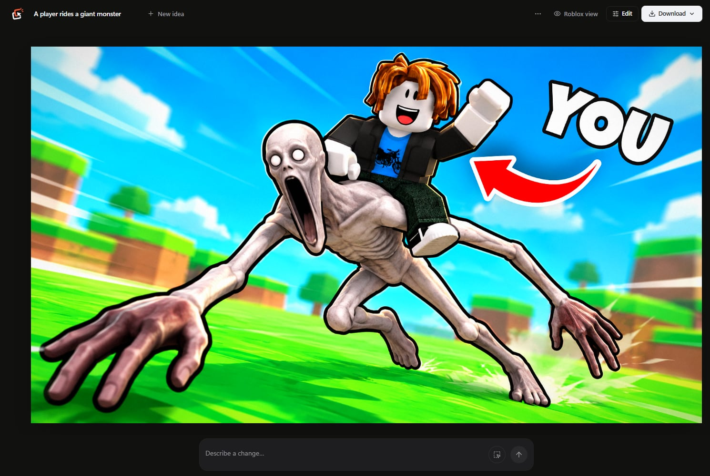
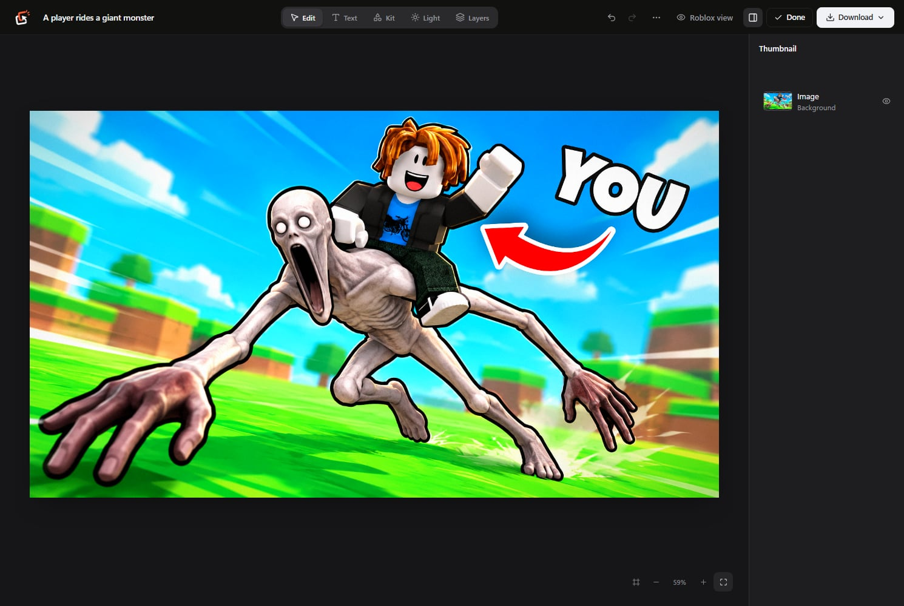

# Bopzi

**A private Windows app for Roblox thumbnails and game icons. It runs on your computer.**

Describe your game and Bopzi draws the image with your own ChatGPT plan. Then change it in plain words, or finish it by hand with text, stickers, lighting and layers.

Bopzi is invite only. Accepted creators get the app and a license key locked to their computer, under a separate 5% game-revenue-share agreement. Your own ChatGPT account then powers the AI images, and usage counts against your own plan.

<p align="center"></p>

## What it does

- **Generate thumbnails and icons** from a sentence, at 1920 × 1080 and 512 × 512.
- **Put your own avatar in the picture.** Type your Roblox username or paste your profile link.
- **Start from a screenshot** of your game and polish it, restyle it, or change one part.
- **Change it in plain words,** optionally inside an area you mark. Every change is kept as a version you can go back to.
- **Borrow a look** from a real Roblox thumbnail, or upload your own style reference.
- **See it the way players will** with Roblox view, before you publish.
- **Finish it by hand** with a kit of stickers and shapes, lighting and layers. Generated images are flattened; the text and images you add on top stay editable.
- **Download a test set** of 2 to 5 thumbnails for Roblox's thumbnail testing.

<p align="center"></p>

## What you need

| | |
|---|---|
| **To use Bopzi** | Windows and a license key for that computer |
| **For AI images** | A paid ChatGPT plan |
| **For development** | Authorized repository access and [Node.js](https://nodejs.org) 20.9 or newer |
| **Tested on** | Windows |

Image generation is not part of the Free ChatGPT plan, and access can vary by plan. Images count against your plan's usage.

## Get started

1. Install Bopzi and open it. The activation screen shows your **device code**.
2. Send that code to the owner. Need help? DM `blvxl` on Discord.
3. Paste the license key you get back. It works only on that computer. Keep it safe: Bopzi logs out whenever it closes, so you paste it each time you open the app.
4. Connect your ChatGPT account from the account menu. Your license and your ChatGPT connection are separate, and Bopzi does not provide a shared ChatGPT login.

Bopzi checks a signed list of disabled keys every hour, and needs to reach it at least once every 7 days. When a new version is out, an **Update** button appears in the top bar. One click downloads it, checks its signature and installs it.

### Authorized development only

```sh
git clone https://github.com/Blvxl/Bopzi.git
cd Bopzi
npm ci
npm run dev
```

Open http://127.0.0.1:3000. A license key or the owner's signing key is needed to get past activation.

## Before you rely on it

> [!WARNING]
> **The ChatGPT connection is unofficial.** Bopzi reads your local Codex sign-in on the server and calls an undocumented ChatGPT backend for images and your profile picture. This route is not supported by OpenAI for other apps. It can change or stop working at any time, and it is your responsibility to check that your use fits OpenAI's terms. See [how the integration works](docs/chatgpt-integration.md).

- **Keep it on your own computer.** Bopzi can use your Codex session and read local files, so never put it on the internet or share your Codex session. See [SECURITY.md](SECURITY.md).
- **Projects stay on this computer.** They are saved as files in `.bopzi\library` in your user folder, and shown only to the license that made them. They survive updates and reinstalls, but they do not sync, and they are not encrypted.
- **Know what leaves your computer.** When you generate, your prompt and attached images go to OpenAI. Avatars, game details and reference thumbnails are fetched from Roblox.
- **Check generated art yourself.** You are responsible for what you publish, including Roblox's rules and other people's rights.

## Build the Windows app

`npm run desktop` opens Bopzi in a development window. `npm run desktop:pack` builds the Windows ARM64 installer in `release/`, and `npm run desktop:pack:x64` builds the x64 one. Both download the matching Codex build and include it in the app.

`npm run release:publish -- "notes"` publishes a signed update. `npm run site:publish` publishes the public site in `site/`. Both need the owner's signing setup and GitHub access.

## Troubleshooting

- **Bopzi cannot find Codex.** Set `BOPZI_CODEX` to the full path of the executable. Optional settings are listed in [.env.example](.env.example).
- **Port 3000 is taken.** Run `npm run dev -- --port 3001`.
- **Running a production build.** Run `npm run build`, set `BOPZI_LOCAL_CHATGPT=1`, then run `npm run start`. This is for a trusted computer, not public hosting.
- **A generation fails.** Bopzi says why: a sign-in problem, your plan's image limit, or a change on ChatGPT's side that needs a Bopzi update. See [the integration notes](docs/chatgpt-integration.md).

## Contributing

This is a private proprietary project. Contributions are accepted only from collaborators authorized by the owner. See [CONTRIBUTING.md](CONTRIBUTING.md). The video editor in `src/video` is unfinished and hidden from the app for now.

## License

The current version of Bopzi is proprietary and is not offered under an open-source license. Earlier copies published under MIT remain subject to the MIT terms that accompanied those copies. Access for approved game creators is governed by a separate agreement; this repository notice does not set those commercial terms. See [LICENSE](LICENSE). Third-party dependencies and bundled assets may have their own terms.

Bopzi is independent and is not affiliated with, endorsed by or sponsored by Roblox Corporation or OpenAI. Roblox and ChatGPT are trademarks of their respective owners.
