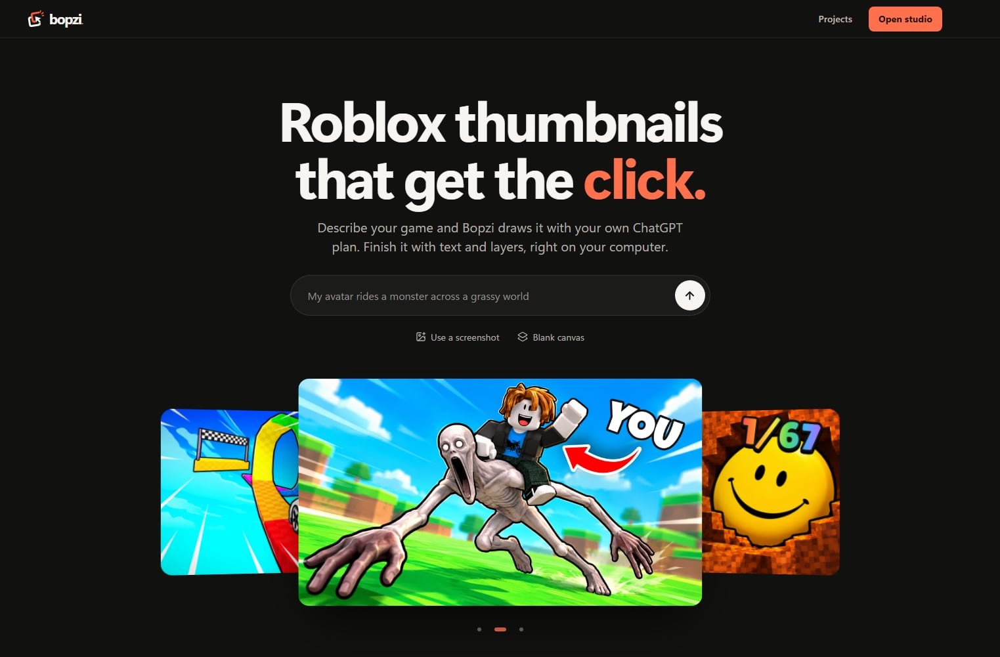

<p align="center"></p>

# Bopzi

**A free, open source studio for Roblox thumbnails and game icons. It runs on your computer.**

Describe your game and Bopzi draws the image with your own ChatGPT plan. Then change it in plain words, or finish it by hand with text, stickers, lighting and layers. There is no Bopzi account and nothing to pay Bopzi.

No ChatGPT plan? The canvas and every manual tool work without one.

<p align="center"></p>

## What it does

- **Generate thumbnails and icons** from a sentence, at 1920 × 1080 and 512 × 512.
- **Put your own avatar in the picture.** Type your Roblox username or paste your profile link.
- **Start from a screenshot** of your game and polish it, restyle it, or change one part.
- **Change it in plain words,** optionally inside an area you mark. Every change is kept as a version you can go back to.
- **Borrow a look** from a real Roblox thumbnail, or upload your own style reference.
- **See it the way players will** with Roblox view, before you publish.
- **Finish it by hand** with a kit of stickers and shapes, lighting and layers. Generated images are flattened; the text and images you add on top stay editable.
- **Download a test set** of 2 to 5 thumbnails for Roblox's thumbnail testing.

<p align="center"></p>

## What you need

| | |
|---|---|
| **To run Bopzi** | [Node.js](https://nodejs.org) 20.9 or newer |
| **For AI images** | [Codex](https://github.com/openai/codex) signed in to a paid ChatGPT plan |
| **Tested on** | Windows. macOS and Linux have not been tested yet, and reports are welcome. |

Image generation is not part of the Free ChatGPT plan, and access can vary by plan. Images count against your plan's usage.

## Get started

```sh
git clone https://github.com/Blvxl/Bopzi.git
cd Bopzi
npm ci
npm run dev
```

Open http://127.0.0.1:3000.

### Connect your ChatGPT plan

Skip this if you only want the manual tools.

```sh
npm install -g @openai/codex
codex
```

Choose **Sign in with ChatGPT**. Bopzi notices the sign-in by itself, and the account button in the top bar shows which account and plan it is using. If something is missing, **Connect** in the top bar walks you through it.

## Before you rely on it

> [!WARNING]
> **The ChatGPT connection is unofficial.** Bopzi reads your local Codex sign-in on the server and calls an undocumented ChatGPT backend for images and your profile picture. This route is not supported by OpenAI for other apps. It can change or stop working at any time, and it is your responsibility to check that your use fits OpenAI's terms. See [how the integration works](docs/chatgpt-integration.md).

- **Keep it on your own computer.** Bopzi can use your Codex session and read local files, so never put it on the internet or share your Codex session. See [SECURITY.md](SECURITY.md).
- **Export what you want to keep.** Projects are stored in this browser on this device, and they are not tied to your ChatGPT account. They do not sync, and clearing browser data removes them.
- **Know what leaves your computer.** When you generate, your prompt and attached images go to OpenAI. Avatars, game details and reference thumbnails are fetched from Roblox.
- **Check generated art yourself.** You are responsible for what you publish, including Roblox's rules and other people's rights.

## Windows desktop app

`npm run desktop` opens Bopzi in a development window. `npm run desktop:pack` builds a Windows ARM64 installer in `release/`; x64 and other platforms are not packaged yet. Packaging can bundle FFmpeg and FFprobe from the build machine, so review their license terms and the installer contents before sharing a build.

## Troubleshooting

- **Bopzi cannot find Codex.** Set `BOPZI_CODEX` to the full path of the executable. Optional settings are listed in [.env.example](.env.example).
- **Port 3000 is taken.** Run `npm run dev -- --port 3001`.
- **Running a production build.** Run `npm run build`, set `BOPZI_LOCAL_CHATGPT=1`, then run `npm run start`. This is for a trusted computer, not public hosting.
- **A generation fails.** Your plan may not include the image model, or the backend may have changed. Check your plan with the account button, then see [the integration notes](docs/chatgpt-integration.md).

## Contributing

Contributions are welcome. See [CONTRIBUTING.md](CONTRIBUTING.md). The video editor in `src/video` is unfinished and hidden from the app for now.

## License

Bopzi's source code is under the [MIT License](LICENSE). Third-party dependencies and bundled assets may have their own terms.

Bopzi is independent and is not affiliated with, endorsed by or sponsored by Roblox Corporation or OpenAI. Roblox and ChatGPT are trademarks of their respective owners.
