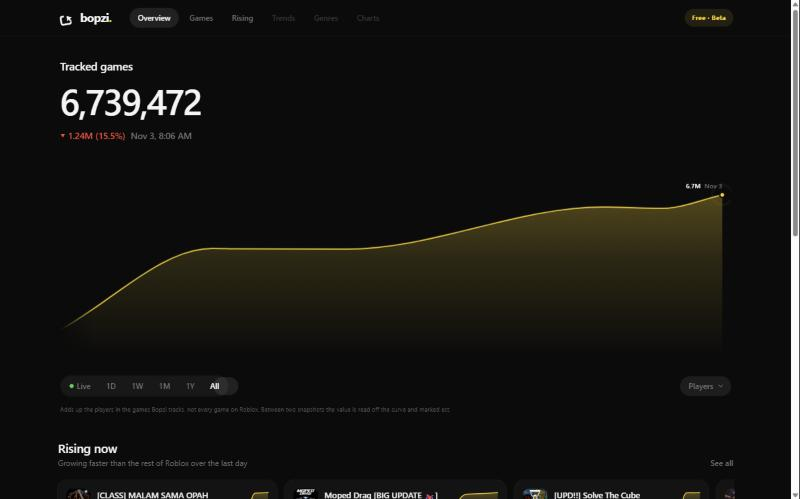
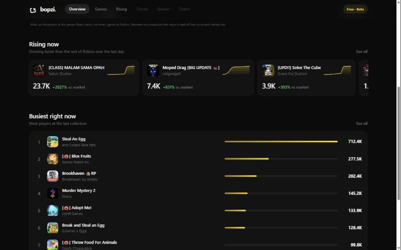

# Bopzi website design

Free Roblox research site: a live chart of how many players are in the games Bopzi tracks, plus what is climbing and what is busiest. Dark, calm, one yellow accent.

Screenshots (from the running dev site): [overview-chart.jpg](design/overview-chart.jpg), [overview-rising-busiest.jpg](design/overview-rising-busiest.jpg), [rising-page.jpg](design/rising-page.jpg).




## Look

| Token | Value |
|---|---|
| Background | `#0b0b0b` |
| Panels | `#131314`, 1px border `rgba(255,255,255,.07)`, radius 20px |
| Accent | `#ffd60a` (yellow): line, fills, bars, active highlights |
| Text / muted | `#f5f5f7` / `#767678` |
| Up / down | `#30d158` / `#ff453a` |
| Font | Inter, falling back to the system font; numbers use tabular figures |
| Motion | `cubic-bezier(.32,.72,0,1)`: page fade-in, card lift on hover, bars grow, digits roll |

Defined in [src/app/globals.css](../src/app/globals.css) (`:root` tokens at the top).

## Layout

1. **Top bar**, full width and sticky, blurred background. Logo `bopzi.` on the left, then pill tabs: Overview, Games, Rising (Trends, Genres, Charts are greyed out: coming soon). A "Free · Beta" pill on the right.
2. **Overview** (`/`), max width 1280px:
   - **Hero chart** across the full width: title "Tracked games", big total with rolling digits, a red/green change figure with the time, then the yellow chart (smooth curve, soft fill, peak label, pulsing end dot). Cursor scrubs smoothly; the part after the cursor dims. Range pill: Live, 1D, 1W, 1M, 1Y, All, with a sliding highlight, and a "Players" pill on the right.
   - **Rising now**: horizontally scrolling cards with the game icon, name, creator, a small yellow sparkline of the last day, the player count, and `+X% vs market` (growth compared with how the whole market moved).
   - **Busiest right now**: ranked list with icon, name, creator, a yellow bar and the player count.
   - Footer note: independent, not affiliated with Roblox; totals cover tracked games only.
3. **Games** (`/games`): all 60 busiest games with a search box.
4. **Rising** (`/rising`): every climbing game in a grid of the same cards.

## Files

| What | Where |
|---|---|
| Page frame, nav | `src/app/layout.tsx`, `src/components/SiteNav.tsx` |
| Pages | `src/app/page.tsx`, `src/app/games/page.tsx`, `src/app/rising/page.tsx` |
| Chart card (header, ranges) | `src/components/ActivityCard.tsx` |
| Chart (curve, cursor, peak, gaps) | `src/components/ActivityChart.tsx` |
| Game icon, sparkline, cards, rows | `src/components/GameParts.tsx` |
| Data hook (refresh every 30 s) | `src/components/useOverview.ts` |
| Data API (totals, top, rising, icons) | `src/app/api/terminal/route.ts` |
| Styles | `src/app/globals.css` |
| Collector that fills the database | `collector/` (`npm run collect:local`) |

## Run it

```sh
npm ci
npm run dev            # site at http://127.0.0.1:3000
npm run collect:local  # in a second terminal: collects Roblox data into data/bopzi.sqlite
```

The site reads `data/bopzi.sqlite`, which is not in git. Without it the page shows empty states until the collector has run for a few minutes; Rising needs a few hours of history.

## Not built yet

Trends, Genres and Charts tabs, game detail pages, watchlist, the AI analyst, and moving the data to Supabase for the public site.
